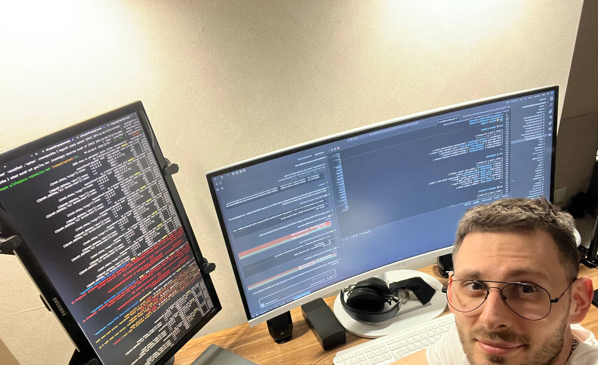

# Hi, I'm Ivan 👋

Embedded firmware developer working with C/C++ and ESP-IDF on real hardware.

🔧 Building on ESP32 with ESP-IDF: peripherals, FreeRTOS, camera-based projects 
📟 Getting into Zephyr RTOS — digging into driver internals (first contribution in progress)

 

### Tech stack
`C` `C++` `ESP-IDF` `FreeRTOS` `ESP32` `STM32` `Zephyr`

### Projects
- [esp32-idf-basics](https://github.com/prokopov-ai/esp32-idf-basics) — ESP-IDF projects, built and flashed on real hardware
